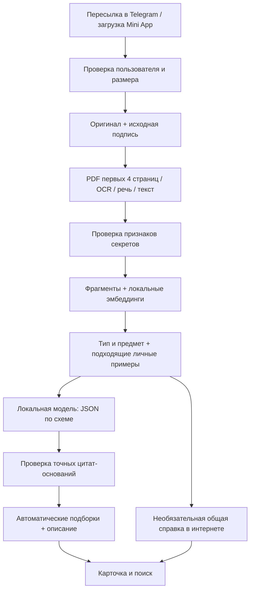

# Архитектура и границы текущей реализации

## Поток нового материала

Существование названия или Telegram file_id не означает, что содержимое прочитано. `has_local_file` отделён от возможности получить материал в Telegram. `analysis_state=needs_original` показывает недоступность оригинала у старых наблюдений и пустых записей.

PDFKit получает текст или изображение только выбранных страниц. PDF-парсер всё равно открывает структуру файла, чтобы получить число страниц и доступ к ним; обещания «не читать ни одного байта остального PDF» нет. По сети файл скачивается целиком, на диск сохраняется целиком, в анализ идёт ограниченный текст.

## Тип, предмет и тема

`Analysis` в `knowledge.py` задаёт ограниченный словарь типов и учебных предметов, список тем, подборки, краткое описание, уверенность и цитаты. Модель отвечает по JSON Schema. Принимаются ответы с уверенностью от 0.5 и хотя бы одной точной цитатой из содержимого/пояснения. Цитата подтверждает присутствие основания в источнике, но сама по себе не доказывает правильность всей классификации. Явные признаки и пояснение пользователя имеют приоритет; при ошибке модели остаются локальные правила.

Для жанра сочинения используются также признаки структуры рассуждения. Учебный предмет не выводится автоматически из темы «дружба» или «история семьи». Совпадение текста по теме не должно подменять жанр.

`canonical_groups` сводит тип и предмет к названиям вроде «Русский язык / Сочинения». Список поддерживаемых типов и предметов можно расширять; это не универсальная онтология. Названия папок в текущей базе хранятся в JSON у записи.

## Память пользователя

Таблица `memories` содержит ссылку на исправленную запись, пояснение, группы, результат анализа и необязательный вектор. Удалённые записи перестают использоваться как примеры. Память не общая между тестировщиками.

Перед новым анализом выбираются до трёх примеров по типу/предмету или векторной близости. После изменения пояснения задача `_review_loop` отбирает связанные записи: совпавший жанр либо семантическая близость, с отсеиванием явно другого жанра. Ручные папки исключены из массового переноса. До 80 кандидатов пересматриваются за один проход. Порог близости — эвристика, его нужно оценивать на отдельной выборке.

Уточнение предмета к сочинению переносится на совпавший жанр, если подходящие примеры не противоречат друг другу. Явное личное название папки применяется при совпадении типа и предмета либо очень высокой близости. Это механизм повторного вывода с примерами; веса Qwen не меняются.

Полная пересборка сначала сохраняет существующие пояснения как ориентиры, затем повторно читает доступные оригиналы и обновляет индекс. Контекст и ручные папки сохраняются. Удалённые записи не включаются. Ошибка одного файла не прерывает всю пачку; итог содержит счётчик ошибок. Задачи живут в процессе и могут прерваться при перезапуске.

## Интернет

`WebVerifier` получает только ключ типа материала. Нельзя передать произвольную строку как поисковый запрос: запрос выбирается из `PUBLIC_QUERIES`/`WIKI_TERMS`. Внешние источники возвращаются как справочные ссылки. Личный текст в поиск не включается, найденная страница целиком не скачивается. Для предварительно распознанного типа короткие справочные выдержки включаются в запрос к локальной модели; последующее определение типа также может добавить ссылки в карточку. Это ограниченная проверка категории, не агент с произвольным браузером. Поиск и интернет-ресурсы могут быть недоступны; локальная классификация от этого не блокируется навсегда.

## Поиск

`chunks` хранят фрагменты и векторы Qwen3 Embedding. Ранжирование сочетает точное совпадение, русские основы слов и косинусную близость. Числа из запроса должны встречаться в материале. Поиск не синтезирует ответ и не выдумывает источник. Все обращения к материалам ограничены user_id.

## Доступ и доставка

Telegram Mini App передаёт подписанный `initData`, сервер проверяет подпись и срок. Пользователи допускаются по владельцу, приглашению или allowlist. Локальный вход использует отдельный ключ, HttpOnly cookie и проверку loopback-адреса/Host. Удалённый туннель не должен предоставлять локальный вход. Изменяющие запросы требуют дополнительного заголовка и проверки Origin. Вложения выдаются с проверкой владельца, потенциально исполняемые оригиналы скачиваются как attachment.

Это меры реализации, а не независимая гарантия безопасности. База обычных материалов открыта для владельца самого Mac. Туннель доставляет данные через Cloudflare. Telegram-боты не являются секретными чатами.

## Парольное хранилище

Web Crypto шифрует отдельный блок на устройстве. Сервер хранит envelope и версию, чтобы старое устройство не перезаписало более новую версию молча. Открытые поля не индексируются. Неверный главный пароль и повреждённый шифротекст отклоняются. Доставка JavaScript и безопасность устройства всё равно остаются частью доверенной системы; независимого аудита нет.

## Провайдеры анализа

Граница генерации — `PersonalAnalyzer.analyse`, результат — проверяемый `Analysis`. Эмбеддинги имеют отдельный вызов `Processor.embed`. Адаптер Gemini расположен в `gemini.py`, с сохранением следующих границ:

- общую схему результата и проверки оснований;
- отдельное согласование передачи личного текста;
- переменные окружения для ключей, без записи в код;
- таймаут, лимит размера и локальное сохранение при сбое;
- одинаковый синтетический набор проверки для обоих провайдеров;
- полное исключение парольного хранилища.

Реализованы локальный Ollama и явное подключение Gemini. `OLLAMA_URL` не принимает внешний адрес. Ключ Gemini принимается отдельным маршрутом только из локальной сессии на Mac, проверяется запросом метаданных модели и атомарно сохраняется в приватном файле `data/ai-settings.json`. Ответы API и экспорт ключ не включают. Удалённый владелец и тестировщики не могут менять подключение.

Gemini получает до четырёх JPEG-страниц, отрисованных PDFKit, либо одно уменьшенное изображение без исходных метаданных. Бинарный оригинал целиком не загружается в Google Files API. `countTokens` считает фактический вход, SQLite-транзакция резервирует стоимость перед генерацией. Максимальный оплачиваемый ответ ограничен; фактическая оценка включает мысли модели. При сетевом обрыве резерв не освобождается автоматически. Запросы без результата не повторяются незаметно. Это программный контроль по опубликованным тарифам, не банковский лимит.

Для изображения Gemini может привести основание, которого нет в плохом OCR. Такое основание помечено как анализ изображения; для текста остаётся проверка цитаты по источнику. Описание и темы входят в поиск, включая случаи без OCR. Сгенерированное описание не может заменить точный номер задания в исходном тексте. При ошибке или исчерпании бюджета используется локальная обработка.
